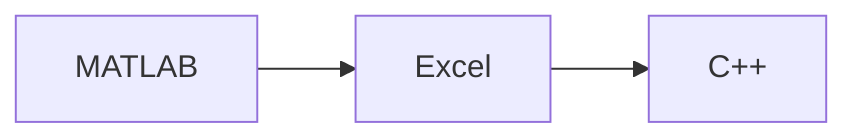

# CET 151 - Intro to Computing in Engineering Technology

College coursework archive for **CET 151 - Intro to Computing in Engineering Technology** at Eastern Michigan University.  
MATLAB (`.m`), Excel automation, C++ exercises, and unit projects from engineering technology computing.

**Author:** [Julio Barros](https://github.com/Jkbarros)  
**Index:** [college-projects](https://github.com/Jkbarros/college-projects)

## What is in this repository

| Area | Description |
|------|-------------|
| Unit folders (`Unit 1` through `Unit 14`, tests) | MATLAB, spreadsheets, and C++ coursework by unit |

### Highlights

- Multiple unit folders with `.m` scripts and spreadsheet work
- C++ source (`.cpp`) from computing units
- Compiled binaries excluded via `.gitignore` (`*.exe`)

## Topics covered

## Related repos

| Course | Link |
|--------|------|
| IA 103 - Information Security Overview | [information-security-overview](https://github.com/Jkbarros/information-security-overview) |
| college-projects index | [college-projects](https://github.com/Jkbarros/college-projects) |

## Roadmap

- [ ] Convert key submissions to markdown in `docs/` (same pattern as IA 103)
- [ ] Redact any sensitive identifiers before expanding public docs

## Notes for readers

- This repo documents **my submitted work** for academic context only.
- EMU or publisher course materials are not redistributed beyond my own submissions in `archive/`.

## License

Content © Julio Barros. Use at your own risk.
