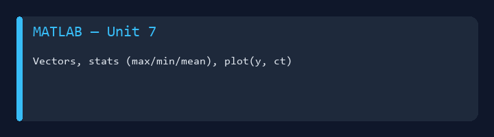
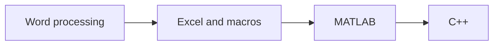

# CET 151 - Intro to Computing in Engineering Technology



College coursework portfolio for **CET 151** at Eastern Michigan University.  
MATLAB scripts, Excel projects (including macro labs), and introductory C++ — with readable notes in `docs/`.

**Author:** [Julio Barros](https://github.com/Jkbarros)  
**Index:** [college-projects](https://github.com/Jkbarros/college-projects)

## What is in this repository

| Area | Description |
|------|-------------|
| [Units catalog](docs/units-catalog.md) | Map every unit to markdown notes and original files |
| [Unit 1 — Word projects](docs/unit-01-project-1a-invitation.md) | Invitation, header, resume (from DOCX) |
| [Unit 2 — Unit conversions](docs/unit-02-project-2c-unit-conversions.md) | Engineering unit conversion write-up |
| [Units 3–5 — Excel](docs/unit-03-05-excel-projects.md) | Spreadsheet projects |
| [Unit 7 — MATLAB plots](docs/unit-07-matlab-plots-and-stats.md) | Vectors, stats, plotting (+ screenshot) |
| [Unit 8 — MATLAB menus](docs/unit-08-matlab-engineering-menus.md) | Moment of inertia + grade calculator |
| [Unit 9 — C++ basics](docs/unit-09-cpp-fundamentals.md) | Hello World and integer math |
| [Unit 11 — C++ area menu](docs/unit-11-cpp-area-menu.md) | Square / rectangle / circle |
| [Units 13–14 — Excel macros](docs/unit-13-14-excel-macros.md) | `.xlsm` automation labs |
| [Tests — MATLAB review](docs/tests-matlab-review.md) | `Test/`, `Test 1/`, `T3/` |
| [Repository guide](docs/repository-guide.md) | Folder layout and file types |

### Highlights

- End-to-end progression: **Word → Excel → MATLAB → C++**
- Runnable `.m` and `.cpp` sources preserved in unit folders
- DOCX submissions converted to GitHub-friendly markdown

## Topics covered



## Run / explore

**MATLAB (Units 7–8, tests):** open scripts under `Unit7/`, `Unit 8/Unit 8/`, or `Test/` in MATLAB or Octave.

**C++ (Units 9, 11, T3):** compile with `g++` from the unit folder (see [Unit 9 doc](docs/unit-09-cpp-fundamentals.md) for legacy header notes).

**Excel:** open `.xlsx` / `.xlsm` locally; macros require Excel with trusted workbooks.

**Regenerate docs assets:**

```bash
pip install -r requirements.txt
python scripts/docx_to_markdown.py
python scripts/generate_readme_demo.py
```

## Related repos

| Course | Link |
|--------|------|
| COSC 111 — Programming & Data Structures | [programming-data-structures-cosc111](https://github.com/Jkbarros/programming-data-structures-cosc111) |
| college-projects index | [college-projects](https://github.com/Jkbarros/college-projects) |

## Notes for readers

- This repo documents **my submitted work** for academic context only.
- EMU or publisher course materials are not redistributed beyond my own submissions in the unit folders.

## License

Content © Julio Barros. Use at your own risk.
