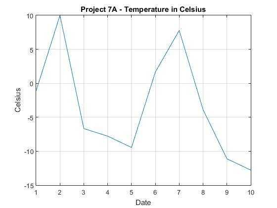

# Unit 7 — MATLAB vectors, statistics, and plots

**Sources:** [`Unit7/U7A.m`](../Unit7/U7A.m) through [`U7E.m`](../Unit7/U7E.m)  
**Course:** CET 151 (EMU) · **Author:** Julio Barros

## What this unit covers

- Fahrenheit → Celsius conversion on arrays (`U7A.m`, `U7B.m`)
- `max`, `min`, `mean` on sample data (`U7C.m`, test-style scripts)
- Plotting polynomials and combined curves (`U7D.m`, `U7E.m`)

## Example — temperature vector and plot (`U7A.m`)

The script builds a Fahrenheit sample vector, converts to Celsius, prints summary stats, and plots:

```matlab
x = [30,50,20,18,15,35,46,25,12,9];
y = [0:10];
ct = ((5/9)*(x-32));
max(x); min(x); mean(x);
max(ct); min(ct); mean(ct);
plot(y, ct);
```



## Example — polynomial plots (`U7E.m`)

```matlab
x = [0:0.1:10];
y = 5 .* x^4 + 4 .* x^3 - 6 .* x^2 + 11 .* x - 35;
z = 5 .* x^0.25 + 4 .* x^0.333 + 2 .* x - 1;
plot(x, z);
```

## Run locally

1. Install [MATLAB](https://www.mathworks.com/products/matlab.html) or GNU Octave.
2. `cd` to `Unit7/` and run a script by name (e.g. `U7A`).
